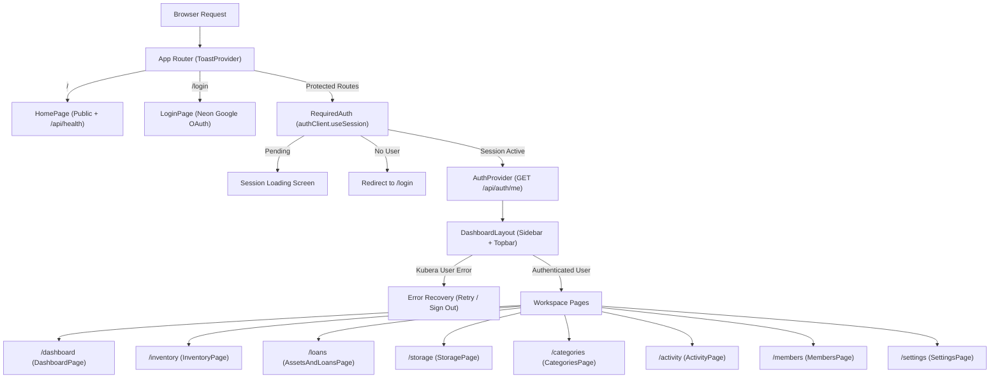
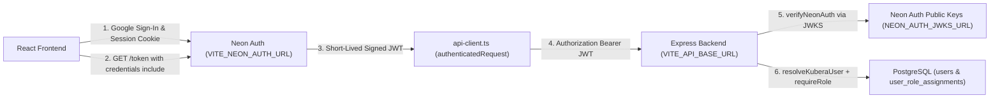
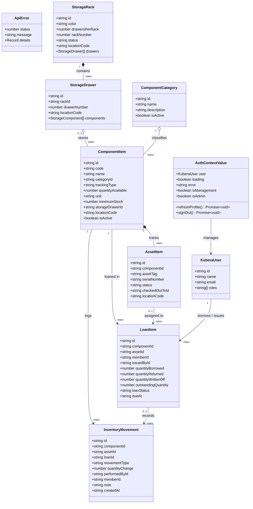

# Kubera Frontend — Robotics Club Inventory Management UI

Modern React + TypeScript frontend for **Kubera**, built directly against the current Kubera Express/Prisma backend API. It provides live inventory browsing, bulk stock & loan workflows, serialized asset tracking, physical color-coded rack/drawer mapping, category management, movement audit logs, and role-aware UI controls.

---

## Table of Contents

- [Tech Stack](#tech-stack)
- [Getting Started](#getting-started)
  - [Environment Variables](#environment-variables)
  - [Available Scripts](#available-scripts)
- [Directory Structure](#directory-structure)
- [Architecture Diagrams](#architecture-diagrams)
  - [1. Routing & Auth Flow](#1-routing--auth-flow)
  - [2. Neon Auth & Backend API Connection Flow](#2-neon-auth--backend-api-connection-flow)
  - [3. Frontend Domain & Service Class Diagram](#3-frontend-domain--service-class-diagram)
- [Design System & Layout Shell](#design-system--layout-shell)
- [Authentication & Role-Based UI Access](#authentication--role-based-ui-access)
- [Routes & Pages Reference](#routes--pages-reference)
- [API Service Layer & Types](#api-service-layer--types)
- [Shared Components & Utilities](#shared-components--utilities)
- [Pending Backend Integrations](#pending-backend-integrations)
- [Frontend Change Log](#frontend-change-log)

---

## Tech Stack

| Layer | Technology | Version (from `package.json`) |
|---|---|---|
| Framework | React | `^19.3.1` |
| Language | TypeScript | `npm:@typescript/typescript6@^6.0.2` |
| Routing | React Router | `^7.18.5` |
| Styling | Tailwind CSS + `@tailwindcss/vite` | `^4.3.4` |
| Icons | Lucide React | `^1.67.0` |
| Auth Client | Neon Auth (`@neondatabase/auth`) | `^0.6.0-beta` |
| Build Tool | Vite | `^8.3.5` |
| Linting | ESLint + `typescript-eslint` + React Hooks/Refresh plugins | `^10.13.0` |

Typography is loaded in `index.html` and mapped in `src/index.css`:
- **UI Sans**: `Inter`
- **Monospace** (SKUs, location codes, asset tags, serial numbers, UUIDs): `JetBrains Mono`

---

## Getting Started

### Environment Variables

Configure `frontend/.env.local`:

```env
VITE_API_BASE_URL=http://localhost:5000/api
VITE_NEON_AUTH_URL=<your-neon-auth-base-url>
```

- `VITE_API_BASE_URL`: Base URL of the Kubera Express backend including `/api`.
- `VITE_NEON_AUTH_URL`: Neon Auth endpoint used by `authClient` (`src/auth/auth.client.ts`) and JWT retrieval (`${VITE_NEON_AUTH_URL}/token` in `src/services/api-client.ts`).

### Available Scripts

Run from `frontend/`:

| Command | Script | Description |
|---|---|---|
| `npm run dev` | `vite` | Start the local Vite development server |
| `npm run build` | `tsc -b && vite build` | Run TypeScript project build check and output production bundle to `dist/` |
| `npm run lint` | `eslint .` | Lint all `.ts` / `.tsx` files |
| `npm run preview` | `vite preview` | Preview the built production bundle |

---

## Directory Structure

```text
frontend/
├── index.html                           # Page title + Inter & JetBrains Mono fonts
├── package.json
├── vite.config.ts
├── eslint.config.js
└── src/
    ├── App.tsx                          # Route definitions + ToastProvider wrapper
    ├── main.tsx                         # React root + BrowserRouter
    ├── index.css                        # Tailwind v4 import, font theme tokens, .bg-blueprint-grid
    ├── App.css
    ├── auth/
    │   ├── auth.client.ts               # Neon Auth createAuthClient + BetterAuthReactAdapter
    │   └── RequiredAuth.tsx             # Session guard + mounts AuthProvider
    ├── context/
    │   ├── auth-context.ts              # AuthContext & useAuth() hook
    │   ├── AuthContext.tsx              # Loads GET /api/auth/me, exposes roles & signOut
    │   ├── toast-context.ts             # ToastContext & useToast() hook
    │   └── ToastContext.tsx             # Global toast notification stack
    ├── components/
    │   ├── common/
    │   │   ├── Badge.tsx                # LocationCodeBadge, TrackingTypeBadge, Asset/Loan/Movement badges
    │   │   ├── EmptyState.tsx           # Reusable empty state card
    │   │   ├── MemberPicker.tsx         # UUID input + "Assign to me" + recent borrowers picker
    │   │   ├── Modal.tsx                # Accessible modal with Escape key & scroll lock
    │   │   ├── Pagination.tsx           # Server-side pagination footer
    │   │   └── StatCard.tsx             # KPI summary card with optional click action
    │   └── layout/
    │       ├── DashboardLayout.tsx      # Responsive sidebar shell + Auth error recovery state
    │       ├── Sidebar.tsx              # Dark obsidian sidebar navigation + user role card + sign out
    │       └── Topbar.tsx               # Sticky header, page metadata, Stock Alerts shortcut, user avatar
    ├── pages/
    │   ├── HomePage.tsx                 # Public landing page + live /api/health status badge
    │   ├── LoginPage.tsx                # Google OAuth sign-in via Neon Auth
    │   ├── DashboardPage.tsx            # Overview KPIs, quick links, movements feed, stock alerts
    │   ├── InventoryPage.tsx            # Component catalog, filters, CRUD, bulk ops, quick asset registration
    │   ├── AssetsAndLoansPage.tsx       # Tabbed My Loans, All Club Loans, and Serialized Assets workspace
    │   ├── StoragePage.tsx              # Rack/drawer explorer, rack CRUD, live Drawer Inspector
    │   ├── CategoriesPage.tsx           # Category CRUD, status filters, component counts
    │   ├── ActivityPage.tsx             # Filterable inventory movement audit log
    │   ├── MembersPage.tsx              # Current user UUID card + borrower snapshot from loans
    │   ├── SettingsPage.tsx             # Kubera profile, role capabilities matrix, API health check
    │   └── PlaceholderPage.tsx          # Legacy placeholder component (currently unused by routes)
    ├── services/
    │   ├── api-client.ts                # authenticatedRequest, publicRequest, buildQueryString, ApiError
    │   ├── auth.api.ts                  # /auth/me, /health
    │   ├── storage.api.ts               # /storage/racks*, /storage/drawers/:id
    │   ├── categories.api.ts            # /components/categories*
    │   ├── components.api.ts            # /components*
    │   ├── assets.api.ts                # /assets*
    │   ├── loans.api.ts                 # /loans*
    │   ├── bulk.api.ts                  # /inventory/bulk/*
    │   └── reports.api.ts               # /inventory/reports/*
    ├── types/
    │   ├── api.ts                       # RoleName, MANAGEMENT_ROLES, ADMIN_ROLES, Pagination, ApiResponse, KuberaUser
    │   ├── storage.ts                   # StorageColor, ALLOWED_DRAWERS, StorageRack, StorageDrawerDetail
    │   └── inventory.ts                 # Category, ComponentItem, AssetItem, LoanItem, LoanDetail, Overview, Alerts, Movements
    └── utils/
        └── format.ts                    # UUID_REGEX, date/time/relative formatters, getInitials, formatRoleLabel
```

---

## Architecture Diagrams

### 1. Routing & Auth Flow



### 2. Neon Auth & Backend API Connection Flow



### 3. Frontend Domain & Service Class Diagram



---

## Design System & Layout Shell

- **Visual Language**: Clean off-white workspace canvas (`bg-slate-50`), elevated white cards (`rounded-2xl border-slate-200/80`), dark obsidian sidebar (`#0B1120`), and blueprint grid accents (`.bg-blueprint-grid`) on public auth/landing screens.
- **Physical Color Coding**:
  - `GREEN` racks/codes → Emerald badges (`emerald-50` / `emerald-700` / `emerald-500` dot)
  - `BLACK` racks/codes → Slate/charcoal badges (`slate-100` / `slate-800` / `slate-700` dot)
  - `ORANGE` racks/codes → Orange badges (`orange-50` / `orange-700` / `orange-500` dot)
- **Layout Shell**:
  - `Sidebar.tsx`: Organizes routes into **Operations** (`Dashboard`, `Inventory`, `Assets & Loans`, `Storage Locations`, `Categories`, `Activity Log`) and **Workspace** (`Members`, `Settings`), displays the signed-in user's name and roles, and includes a Sign Out button.
  - `Topbar.tsx`: Sticky header displaying route-specific titles/subtitles, a direct `Stock Alerts` pill linking to `/inventory?stockStatus=LOW_STOCK`, and the user's initials and primary role from `/api/auth/me`.
  - `DashboardLayout.tsx`: Handles mobile sidebar drawer state, loading indicator while resolving the Kubera profile, and a dedicated error/retry/sign-out state if `/api/auth/me` fails (e.g., user signed into Neon Auth but not yet active/registered in Kubera).

---

## Authentication & Role-Based UI Access

1. **Session Verification (`src/auth/RequiredAuth.tsx`)**:
   - Checks `authClient.useSession()`. Unauthenticated users are redirected to `/login`.
   - Once a Neon Auth session is active, `RequiredAuth` mounts `<AuthProvider>`.
2. **Kubera User Resolution (`src/context/AuthContext.tsx`)**:
   - Calls `GET /api/auth/me` with `Authorization: Bearer <neon-jwt>`.
   - Stores `user` (`id`, `name`, `email`, `roles`) and derives two permission helpers (defined in `src/types/api.ts`):
     - `isManagement`: true if `user.roles` includes any of `SUPER_ADMIN`, `ADMIN`, `CLUB_PRESIDENT`, `VICE_PRESIDENT`.
     - `isAdmin`: true if `user.roles` includes any of `SUPER_ADMIN`, `ADMIN`, `CLUB_PRESIDENT`.
3. **UI Gating vs. Backend Enforcement**:
   - The UI shows/hides management/admin buttons (such as creating components, issuing loans, bulk adjustments, managing categories, or retiring/deleting racks) based on `isManagement` and `isAdmin`.
   - The backend remains the authoritative RBAC enforcer on all routes.

---

## Routes & Pages Reference

### Public Routes
- **`/` — `HomePage.tsx`**
  - Landing page introducing Kubera's location code system (`GREEN-R03-C01-D02`), dual tracking modes, audit trail, and RBAC.
  - Pings `GET /api/health` on load to display a live `Backend API Online` / `Backend Offline` status pill.
  - Routes signed-in users directly to `/dashboard` or guests to `/login`.
- **`/login` — `LoginPage.tsx`**
  - Redirects already-authenticated sessions to `/dashboard`.
  - Triggers Google social sign-in via `authClient.signIn.social({ provider: "google", callbackURL: "/dashboard" })`.

### Authenticated Routes (inside `RequiredAuth` + `DashboardLayout`)

- **`/dashboard` — `DashboardPage.tsx`**
  - **Endpoints**: `GET /api/inventory/reports/overview`, `GET /api/inventory/reports/stock-alerts`, `GET /api/inventory/reports/movements?page=1&limit=6`, and `GET /api/loans/summary` (management) or `GET /api/loans/me/summary` (members).
  - **Features**:
    - 4 clickable KPI `StatCard`s (Active Components, Bulk Units Available, Outstanding/My Active Loans, Stock Alerts).
    - Quick navigation cards to Storage Map, Loans & Serialized Assets, and Audit Trail.
    - Live recent movements feed with quantity delta (`+`/`-`), performer, member, and relative timestamp.
    - Low & out-of-stock alerts panel with location badges and stock vs. `minimumStock` counts.

- **`/inventory` — `InventoryPage.tsx`**
  - **Endpoints**:
    - `GET /api/components` (`search`, `categoryId`, `trackingType`, `storageDrawerId`, `status`, `stockStatus`, `page`, `limit`)
    - `POST /api/components`, `PATCH /api/components/:id`, `PATCH /api/components/:id/activate`, `PATCH /api/components/:id/deactivate`
    - `POST /api/inventory/bulk/stock-in`, `POST /api/inventory/bulk/checkout`, `POST /api/inventory/bulk/adjust`, `POST /api/inventory/bulk/write-off`
    - `POST /api/assets`
    - Metadata lookups: `GET /api/components/categories?status=ACTIVE`, `GET /api/storage/racks?status=ACTIVE`
  - **Features**:
    - Reads URL search params (`search`, `categoryId`, `trackingType`, `stockStatus`, `storageDrawerId`) for deep-linking from Dashboard, Topbar, and Storage Inspector.
    - Debounced server-side search, multi-filter bar, status toggle (`ACTIVE` / `INACTIVE` / `ALL`), and server pagination.
    - **Create / Edit Component Modal**: validates non-negative integers, enforces `initialQuantity` only on `BULK` components, and maps active storage drawers by location code.
    - **Bulk Operations Modal** (on active `BULK` components): tabbed workflow for **Stock In**, **Checkout** (with `MemberPicker` and future due-date validation), **Adjust** (non-zero integer delta + required reason), and **Write Off** (`DAMAGED` / `LOST` + required note).
    - **Register Asset Modal** (on active `INDIVIDUAL` components) + direct link to `/loans?tab=assets&componentId=<id>`.

- **`/loans` — `AssetsAndLoansPage.tsx`**
  - Supports `?tab=my-loans|all-loans|assets` and `?componentId=<uuid>`.
  - **Tabs**:
    1. **My Loans**: `GET /api/loans/me/summary` + `GET /api/loans/me`
    2. **All Club Loans** (management only): `GET /api/loans/summary` + `GET /api/loans`
    3. **Serialized Assets**: `GET /api/assets` + individual components filter
  - **Endpoints & Actions**:
    - **Loan Timeline Modal**: `GET /api/loans/:loanId` showing borrower, issuer, due date, and movement timeline.
    - **Extend Due Date** (management): `PATCH /api/loans/:loanId/due-date` (validates future date).
    - **Bulk Loan Return / Write-Off** (management, on bulk loans): `POST /api/inventory/bulk/return`, `POST /api/inventory/bulk/loan-write-off` (`DAMAGED` | `LOST` with required description).
    - **Register / Checkout / Return Asset** (management): `POST /api/assets`, `POST /api/assets/:assetId/checkout`, `PATCH /api/assets/:assetId/return`.

- **`/storage` — `StoragePage.tsx`**
  - **Endpoints**: `GET /api/storage/racks?status=ACTIVE|RETIRED|ALL`, `GET /api/storage/drawers/:drawerId`, `POST /api/storage/racks`, `PATCH /api/storage/racks/:rackId/retire`, `PATCH /api/storage/racks/:rackId/restore`, `DELETE /api/storage/racks/:rackId`.
  - **Features**:
    - Summary cards (Total Racks, Total Drawers, Occupied Drawers).
    - Search across rack codes, drawer codes, component names, and SKUs, plus `ACTIVE` / `RETIRED` / `ALL` filter.
    - Expandable color-grouped rack accordions (`GREEN`, `BLACK`, `ORANGE`).
    - **Add Storage Rack Modal** (management): enforces `ALLOWED_DRAWERS` per color (`GREEN`: `[3]`, `BLACK`: `[2, 3, 4]`, `ORANGE`: `[2]`).
    - **Retire / Restore / Delete Rack** actions (admin roles), disabling retire/delete when drawers still hold active components.
    - **Live Drawer Inspector**: fetches drawer details on click and links to `/inventory?storageDrawerId=<id>`.

- **`/categories` — `CategoriesPage.tsx`**
  - **Endpoints**: `GET /api/components/categories?status=ACTIVE|INACTIVE|ALL`, `POST /api/components/categories`, `PATCH /api/components/categories/:id`, `PATCH /api/components/categories/:id/activate`, `PATCH /api/components/categories/:id/deactivate`, `DELETE /api/components/categories/:id`.
  - **Features**: Status filter tabs, client-side search, component count display (`_count.components`), create/edit modal, activate/deactivate toggle, and delete guard for non-empty categories (admin roles).

- **`/activity` — `ActivityPage.tsx`**
  - **Endpoints**: `GET /api/inventory/reports/movements` + `GET /api/components?status=ALL&limit=100` for filter dropdown.
  - **Features**: Filter by `movementType` (`STOCK_IN`, `CHECKOUT`, `RETURN`, `ADJUSTMENT`, `MARK_DAMAGED`, `MARK_LOST`, `RETIRE`), component, and `from`/`to` date range (validated so `from <= to`), with full audit table and pagination.

- **`/members` — `MembersPage.tsx`**
  - **Endpoints**: Uses `useAuth()` (`/api/auth/me`) and `GET /api/loans?page=1&limit=100` (management roles).
  - **Features**: Displays a clear notice about pending `/api/members` backend routes, shows the signed-in user's Kubera UUID with one-click copy, and (for management) aggregates active/historical borrowers from loan records with total, outstanding, and overdue loan counts.

- **`/settings` — `SettingsPage.tsx`**
  - **Endpoints**: `GET /api/auth/me` (sync button) and `GET /api/health` (connection diagnostics).
  - **Features**: Account profile details, assigned role badges, effective RBAC capabilities checklist, `VITE_API_BASE_URL` connectivity status, and sign-out action.

---

## API Service Layer & Types

### `src/services/api-client.ts`
- `authenticatedRequest<T>(endpoint, options)`: Fetches a fresh Neon JWT from `${VITE_NEON_AUTH_URL}/token` (`credentials: "include"`), attaches `Authorization: Bearer <token>` and `Content-Type: application/json` (when `body` is present), and throws structured `ApiError(message, status, details)` on non-2xx responses.
- `publicRequest<T>(endpoint)`: Used for public endpoints (`/health`).
- `buildQueryString(params)`: Omits empty/`null`/`undefined` query parameters cleanly.

### Service Modules
| Module | File | Backend Prefix |
|---|---|---|
| Auth & Health | `src/services/auth.api.ts` | `/api/auth`, `/api/health` |
| Storage | `src/services/storage.api.ts` | `/api/storage` |
| Categories | `src/services/categories.api.ts` | `/api/components/categories` |
| Components | `src/services/components.api.ts` | `/api/components` |
| Assets | `src/services/assets.api.ts` | `/api/assets` |
| Loans | `src/services/loans.api.ts` | `/api/loans` |
| Bulk Inventory | `src/services/bulk.api.ts` | `/api/inventory/bulk` |
| Reports | `src/services/reports.api.ts` | `/api/inventory/reports` |

---

## Shared Components & Utilities

- **`src/components/common/Badge.tsx`**: `LocationCodeBadge`, `TrackingTypeBadge`, `AssetStatusBadge`, `LoanStatusBadge`, `MovementTypeBadge`.
- **`src/components/common/Modal.tsx`**: Reusable modal dialog with backdrop blur, `Escape` key handler, and body scroll locking.
- **`src/components/common/Pagination.tsx`**: Consistent range summary (`Showing X–Y of Z`) and Prev/Next controls.
- **`src/components/common/StatCard.tsx`**: Metric card with tabular numerals and optional interactive click behavior.
- **`src/components/common/EmptyState.tsx`**: Centered dashed empty-state display.
- **`src/components/common/MemberPicker.tsx`**: Smart borrower UUID selector supporting "Assign to me", quick-pick from recent borrowers (loaded from `GET /api/loans`), and manual UUID entry with live `UUID_REGEX` validation.
- **`src/utils/format.ts`**: `UUID_REGEX`, `formatDate`, `formatDateTime`, `formatRelativeTime`, `getInitials`, `formatRoleLabel`, and `toLocalDateTimeInputDefault`.

---

## Pending Backend Integrations

The frontend aligns strictly with currently implemented backend routes. The following areas are marked as pending backend development:

1. **Member Directory & Role Assignment (`/api/members`, `/api/users`)**:
   - No backend user-listing or role-management endpoints exist yet.
   - **Current UI handling**:
     - `MembersPage.tsx` explains this status explicitly and derives a borrower directory from `GET /api/loans` for management roles.
     - Checkout modals (`InventoryPage.tsx` and `AssetsAndLoansPage.tsx`) use `MemberPicker.tsx`, allowing management to select themselves, pick a recent borrower from loans, or paste any member's Kubera UUID.
2. **Legacy File**:
   - `src/pages/PlaceholderPage.tsx` from the initial starter scaffold is still present on disk but is no longer wired to any route in `src/App.tsx`.

---

## Frontend Change Log

Recent commits on `main` implementing this UI:

- `62fe3a9` — `feat(frontend): add API services, types, and auth/toast contexts`
- `7f8a14e` — `feat(frontend): redesign app shell, routing, and shared UI components`
- `3c9aaf9` — `feat(frontend): implement live UI pages against current backend API`

Verified locally in `frontend/` via `npm run lint` (`0` errors, `0` warnings) and `npm run build` (`tsc -b && vite build`).
